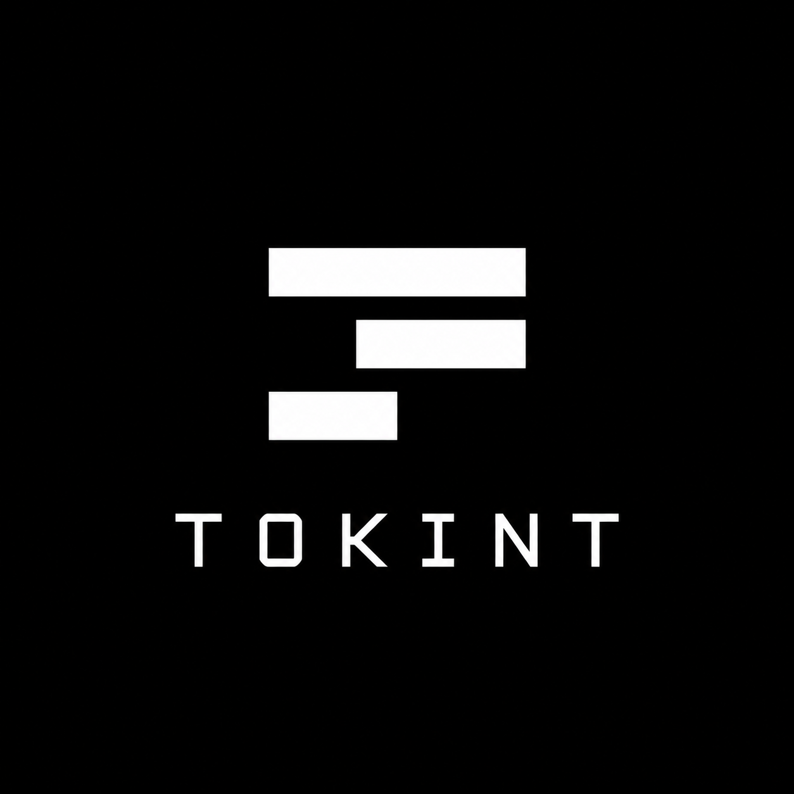

# TOKINT



A Chromium extension for Ethereum mainnet contract inspection, NFT metadata, IPFS links, and local image conversion. Requests go directly from your browser to the configured providers. No wallet, signing, or account is required for the core features.

## Core functionality

- Inspect Ethereum mainnet ERC-721/1155 metadata using a contract address and exact token ID.
- Open contract, token, and IPFS lookups from the address bar, or detect a token from the current tab using the toolbar button.
- View JSON, attributes, storage locations, and selectable artwork; download originals or convert supported images and animations locally.
- Reopen recent tokens from a local cache, including offline when their content is cached.
- Optionally use Alchemy for collection/wallet browsing and ownership/mint information.

### What works with each provider

| Function | PublicNode, dRPC, 1RPC, or a custom mainnet RPC | Alchemy mainnet RPC with NFT API access |
| --- | --- | --- |
| Inspect a known contract/token ID; view metadata and artwork | Yes | Yes |
| `tokint` + Tab, toolbar detection, and IPFS links | Yes | Yes |
| Original downloads, local conversion, and recent-token cache | Yes | Yes |
| Browse tokens in a collection or public wallet | No | Yes, using Alchemy's NFT index |
| View indexed owners and mint details | No | Yes, when indexed data is available |

Start with the defaults for individual token lookups. [Enable Alchemy](#enable-alchemy)
when you want to discover tokens without already knowing their IDs, browse a
wallet, or look up ownership and mint information. The IPFS gateway is a separate
setting and works with either choice of RPC provider.

## Install

Use Chrome, Brave, or another Chromium browser that supports unpacked Manifest V3 extensions. The manifest requires Chromium 109 or later; use a current browser for media decoding and conversion support.

1. Extract the release folder to a permanent location. If you have source only, [build it](#development) first.
2. Open `chrome://extensions`, `brave://extensions`, or `edge://extensions`.
3. Enable **Developer mode**, choose **Load unpacked**, and select **`extension/`**, the folder containing `manifest.json`.
4. Pin tokint to the toolbar if desired. Clicking it opens the inspector in a new tab.

The supplied build needs no Node.js installation. Settings are available from the inspector's gear icon or the browser's extension management page.

The manual-install ZIP, `tokint-<version>.zip`, contains `extension/`; extract it before choosing **Load unpacked**. The separate `tokint-<version>-chrome-web-store.zip` is for store submission, and the source ZIP is for development.

TOKINT uses one extension and one address-bar keyword: **`tokint` + Tab**. It recognizes Ethereum addresses, address/token-ID pairs, and IPFS references automatically. If upgrading from the former two-extension setup, remove the old **TOKINT IPFS** companion from the browser; it is no longer needed.

### First lookup

1. Keep the default PublicNode RPC and Pinata gateway in Settings; no account is needed.
2. Type `tokint`, press **Tab**, paste `0xff9c1b15b16263c61d017ee9f65c50e4ae0113d7 1`, and press **Enter** to inspect Loot #1. Alternatively, open the toolbar inspector and enter the address and token ID in their separate fields.
3. Review the metadata and artwork. If a referenced host needs permission, use **Allow and retry** to permit it.
4. Use **Media source** when multiple assets are available, then the download icon to save the original or convert it locally. Successful metadata lookups appear in Recents.

Public providers can be unavailable or rate-limited; the [error guidance](#privacy-permissions-and-errors)
explains how to retry or change providers.

## Inspect a token

Enter a full contract address and decimal token ID, then press **Enter** or click **Inspect**. **Auto detect** probes the standard metadata interfaces and tries `tokenURI` or `uri`; select a method manually for contracts that need it. Large token IDs retain full uint256 precision, and ERC-1155 `{id}` placeholders are expanded automatically. Custom metadata functions are not supported, and an ERC-1155 URI response alone does not prove a token exists.

On a fresh lookup, TOKINT uses your RPC provider to read the contract's metadata
URI, resolves IPFS references through your chosen gateway, and reads the returned
JSON and referenced artwork. Embedded data is decoded locally. A usable cached
snapshot can supply metadata and media instead; **Refresh** requests current data.
The RPC provider supplies contract reads, the gateway or content host supplies
files, and your browser performs display and conversion. For `https://arweave.net/<transaction-ID>`
content, TOKINT calculates the transaction-specific subdomain and requests it directly,
including for artwork and original downloads. This supports Arweave's standard
[sandbox routing](https://docs.ar.io/build/advanced/sandboxing/) without an HTTP redirect.

The inspector shows the original metadata URI, resolved URL, JSON, attributes, and image preview. JSON is normally indented; large or deeply nested objects use compact formatting to keep display memory bounded. Metadata deeper than 64 object/array levels is rejected. Use the copy and external-link controls to inspect sources. The contract link opens Etherscan's Read Contract page. When metadata provides multiple distinct assets, the Media source dropdown in the preview footer switches between `image`, `animation_url`, `image_url`, inline SVG `image_data`, other media aliases, and `properties.files` entries. Duplicate media values share one entry; the selector is hidden when only one distinct value remains. The selected asset drives the preview, storage badge, source link, original download, and conversion tools. Animated image formats work from any of these fields. Base64 HTML animations also preview in an isolated sandbox. Audio and video remain outbound links. The OpenSea and OnChainChecker logos beneath the media open the submitted token on each service in a new tab. Both logos are bundled locally; the services are contacted only when you follow a link.

Click the toolbar button on an OpenSea, SuperRare, or other HTTP(S) page with adjacent `/contract-address/token-ID` path segments to open that token automatically. The source tab stays open. Unsupported or ambiguous URLs require manual entry. Only Ethereum mainnet is supported: recognized non-mainnet labels are rejected, while unlabeled URLs are assumed to be mainnet. Website URL conventions cannot reliably identify every chain.

### Address-bar commands

Type `tokint`, press **Tab**, then enter:

| Input | Action |
| --- | --- |
| `0x<40-hex-character address>` | Open Etherscan Read Contract |
| `0x<address> 123` | Inspect token 123 |
| `ipfs://<CID>/path`, `<CID>/path`, or `/ipfs/<CID>/path` | Open the configured IPFS gateway |
| An IPFS gateway URL, such as `https://ipfs.io/ipfs/<CID>/path` | Open the same IPFS reference through the configured gateway |

For example, `0xff9c1b15b16263c61d017ee9f65c50e4ae0113d7 1` inspects Loot #1. Suggestions make no network requests; requests begin after submission.

### Recent tokens and cache

The inspector remembers the last **30 distinct successfully loaded tokens**. Selecting a recent token restores its address, exact ID, and metadata method. Metadata and successfully decoded preview originals are cached in IndexedDB and eligible for reuse for **24 hours**, within a **50 MiB** total payload budget. Expired snapshots are removed during cache maintenance rather than by an exact deletion timer. Older snapshots are evicted as needed; recent-token shortcuts can remain after their files are evicted.

**Cached · time** identifies reused metadata. Fully cached tokens can reopen offline. **Refresh** bypasses the application and HTTP caches and fetches the contract, metadata, and media again. Changing RPC or gateway settings also makes previous snapshots ineligible. Cache failures do not block ordinary lookups.

The trash icon clears history and cached files across open inspector tabs without changing settings. Data stays local and is not synced. On-demand original downloads and Alchemy browsing results are not added to this cache.

### Storage badges and appearance

Media and metadata have separate storage badges:

- **On-chain:** JSON returned as a data URI, or media embedded in that JSON.
- **Decentralized:** recognized IPFS or Arweave references.
- **Centralized:** other HTTP(S) sources.

Embedded media inherits its metadata's location; external media is classified independently. Badges describe URI location, not permanence or immutability. Native `ar://` references can be classified, but loading requires an HTTP gateway URL.

Use the sun/moon button for a saved light or dark theme, the info button for help, and the expand button for a fullscreen image. Escape closes dialogs. Loading indicators respect reduced-motion preferences.

## Download and convert

The Media download button opens **Download/Convert**. Choose **Original** to save the selected image or HTML bytes unchanged, or adjust the export controls, click **Convert**, inspect the preview, and click **Download**. All conversion runs locally; media is never uploaded to a conversion service.

The dialog checks browser decoding, canvas encoding, and WebAssembly support.
Unavailable export formats are disabled with an explanation; original downloads
remain available. Updating the browser may enable additional conversion formats.

| Source | Converted output |
| --- | --- |
| JPEG, PNG, static WebP, supported static SVG | JPEG |
| Animated GIF or WebP | Looping GIF or WebP |
| Supported animated SVG | Looping GIF or WebP clip |
| HTML canvas animation | GIF or animated WebP, plus original HTML download |
| Other formats | Original image download or source link |

- Set a maximum edge of **1–2000 px**. HTML and SVG exports can scale up to the selected size while preserving aspect ratio. Raster exports never enlarge the original.
- Choose black or white to flatten transparency. Animation controls offer Original timing for raster sources or a **10–50 fps** cap; SVG defaults to **20 fps** and supports **0.1–60-second** clips.
- Outputs must fit **5 MB for JPEG** or **15 MB for animation**. Compression can change appearance and may reduce dimensions to fit. These limits do not guarantee acceptance by a particular social platform.
- Changing options, closing the dialog, cancelling, or loading another token stops pending conversion and clears stale exports.
- Converted filenames use `contract--id--title--web.extension`, with the loaded token's full lowercase address, exact ID, and a lowercase, hyphenated metadata title. For example: `0x33fd426905f149f8376e227d0c9d3340aad17af1--410--freedom-to-retract--web.jpg`. Spaces and punctuation become hyphens, long titles are shortened, and missing/unusable titles become `untitled`. Original downloads use `0x<contract>--123--media.png`.

Automatic remote previews have a **100 MiB download limit** and a **30-second timeout**. If a preview is too large or slow, use **Download/Convert → Original** to retrieve it explicitly, or open its source URL. Explicit original downloads have no application file-size cap or fixed total timeout; browser memory and decoding limits still apply. Conversion has a separate **100 MiB input limit**. Raster conversion allows up to 32 million pixels per frame, 1000 frames, 160 million total source pixels, and 10 minutes of source animation, with a two-minute generation timeout.

SVG export supports a bounded subset of declarative SMIL and CSS keyframe animation. Scripts, event-based timing, embedded HTML/images, external assets/fonts, and unsupported timing patterns are rejected for conversion. SVG limits are 2 MiB of markup, 10,000 elements, 32 million source pixels, 3000 output frames, and five minutes of generation. Unsupported artwork can still be downloaded unchanged. SVG is decoded as an image, never inserted as live markup into the extension page.

HTML previews accept `data:text/html` (base64 or percent-encoded) and HTTP responses with `text/html`. They run in a separate, opaque sandbox with no extension APIs, external requests, frames, forms, or popups. Original downloads retain the exact HTML bytes. Canvas exports sample the largest canvas using the existing GIF/WebP controls, with a 0.1–60 second clip and a 20 fps default. Sampling advances animation callbacks and JavaScript timers on a controlled clock; artwork relying on external resources, real-time input, or non-canvas DOM rendering may preview differently or have no convertible canvas. HTML input is limited to 2 MiB.


## Settings

Open Settings with the inspector's gear icon. Click **Save settings** to apply changes to subsequent lookups. Alchemy controls also update in open inspector tabs when the saved RPC configuration changes.

| Setting | Default | Purpose and choices |
| --- | --- | --- |
| Ethereum mainnet RPC provider | PublicNode | PublicNode, dRPC, 1RPC, optional Alchemy, or Custom RPC. Used for contract reads; the endpoint must report chain ID 1. |
| Ethereum mainnet RPC URL | `https://ethereum-rpc.publicnode.com` | Presets fill this automatically. Use HTTPS without embedded username/password credentials. Plain HTTP is accepted only for literal `localhost` or `127.0.0.1` addresses, with an optional port. |
| Public IPFS gateway | Pinata | Pinata, Filebase, IPFS.io, dweb.link, or Custom gateway. IPFS references are resolved through this provider. |
| IPFS gateway base URL | `https://gateway.pinata.cloud` | An HTTPS base URL with no `/ipfs/` path, query, or fragment. Plain HTTP is allowed only on the same literal loopback hosts as RPC URLs. Select Custom gateway to edit it. |
| Gateway URL style | Path | Path produces `gateway/ipfs/CID/path`; Subdomain produces `CID.ipfs.gateway/path`. Localhost/IP-address gateways require Path. Presets choose their own style. |

**Restore defaults** fills the form; click **Save settings** to apply it. Theme is changed separately with the sun/moon button. Clearing Recents removes history and cached files without changing settings.

RPC and content requests use direct URLs. Arweave transaction URLs are resolved to their deterministic sandbox subdomains before content is fetched. Other automatic HTTP redirects are blocked before contacting their destinations. If a provider or path-style gateway redirects, use its direct endpoint, choose another gateway/style, or follow the source link in a normal browser tab. The extension does not silently switch providers.

## Optional Alchemy features

Alchemy serves two roles: its RPC endpoint handles the same contract reads as
other providers, and its NFT API adds indexed collection, wallet, ownership, and
mint information. TOKINT uses the same configured Alchemy application for both.
These additional controls are hidden when the saved RPC URL is not a supported
Alchemy endpoint.

### Enable Alchemy

1. In the [Alchemy dashboard](https://dashboard.alchemy.com/), obtain the Ethereum mainnet HTTPS RPC URL for an application with NFT API access.
2. Open TOKINT **Settings**, select **Alchemy (optional)** under **Ethereum mainnet RPC provider**, and paste the complete URL. TOKINT recognizes the form `https://eth-mainnet.g.alchemy.com/v2/<your-application-key>`; replace the placeholder with the URL supplied by Alchemy. An NFT API URL, another chain's URL, or a proxy/custom hostname does not enable these controls.
3. Click **Save settings** and return to the inspector. Collection and wallet browse buttons appear beside the lookup controls. **Ownership & mint** becomes available when you submit a valid contract/token pair.
4. On the first request, use **Allow and retry** if Chrome needs permission to contact Alchemy. Saving the URL enables the controls but does not verify that the application has working RPC and NFT API access.

The complete endpoint is saved in this browser profile, including its application
key. There is no separate TOKINT account or wallet connection. Alchemy receives
the contract, token, or public wallet identifiers needed for your requests.
See the [privacy policy](public/privacy.html) for storage and provider details.

### Browse a collection or wallet

| Control | How to use it | What happens |
| --- | --- | --- |
| **Browse collection** (grid icon) | Enter a complete contract address in the inspector, then click the icon. A token ID is not required. | The collection browser opens and immediately requests the first page. You can change the contract inside the dialog and click **Browse** again. |
| **Browse wallet** (wallet icon) | Click the icon, enter a full `0x` wallet address, and click **Browse**. ENS names are not supported. | The browser lists tokens indexed as owned by that address across Ethereum mainnet collections. The wallet can be any public address; you do not connect it or prove ownership. |

Results contain up to **24 tokens per page**. Use **Next** and **Previous** to
navigate; Next is available only when Alchemy supplies another page. Cards show
the indexed name, token ID, and contract identity. Invalid entries may be omitted.
Clicking a card closes the browser and submits that contract/token pair to the
normal inspector using **Auto detect**. Its metadata and selected artwork follow
the normal RPC/gateway/cache path, with the same original-download and conversion
controls. The browse-card thumbnail is not used as the original artwork.

Address-bar inputs keep their normal meaning with Alchemy enabled: a bare address
opens Etherscan, and an address plus token ID opens the inspector. Use **Browse
wallet** for wallet holdings; the address-bar command does not infer that intent.

### Thumbnails and ownership details

Browse cards work without images. **Load thumbnails** requests access to
`nft-cdn.alchemy.com` and Alchemy's resources on `res.cloudinary.com`. Once that
permission is granted, eligible thumbnails load automatically on subsequent
browse pages. Missing, unsupported, or failed thumbnails leave the token cards
usable. Thumbnails are temporary previews and are not added to the recent-token
media cache; optional site access can be revoked in the browser's extension controls.

After submitting a token, expand **Ownership & mint** to request its indexed
owners and available mint date, recipient, transaction, and block. Addresses,
transactions, and blocks link to Etherscan. **Minted to** is the mint recipient,
which does not establish who created the artwork. Owner output is capped at
**100 addresses**; when coverage is incomplete, **Partial list · View holders**
links to Etherscan. Missing indexed fields appear as unavailable.

Use **Refresh Alchemy details** inside this panel to request updated index data.
The displayed **Queried** time records when TOKINT requested it, not the age of
Alchemy's underlying index. An expanded panel also reloads when you submit another
token; there is no background polling. Alchemy results can lag the chain or omit
tokens/details. Browsing and ownership results require a network connection and
are separate from the inspector's local recent-token cache.

### Alchemy troubleshooting and disabling

| Symptom | Check or action |
| --- | --- |
| Alchemy buttons are hidden | Save the supported Ethereum mainnet RPC URL shown above. Other networks, proxy hosts, and placeholder URLs do not enable the features. |
| Browse collection is disabled | Enter a valid full contract address in the inspector. A token ID is not needed for collection browsing. |
| Host access was not granted | Use **Allow and retry** and approve the requested Alchemy host if you want the lookup to proceed. Thumbnail host access is separate. |
| Configuration rejected / HTTP 401 or 403 | Check the endpoint and the application's NFT API access in Alchemy. A successful RPC lookup does not prove NFT API access is available. |
| Rate limited / HTTP 429 | Wait before retrying and check the application's usage limits in Alchemy. |
| No tokens, missing mint fields, or partial owners | Confirm the address/token and Ethereum mainnet. Index coverage can be incomplete or delayed; use the available Etherscan links to investigate. |

To disable the extra features, choose another RPC provider and **Save settings**.
TOKINT hides the Alchemy controls, closes its browse dialog, and cancels pending
Alchemy requests. Core inspection, IPFS, downloads, conversion, and Recents remain
available with the selected provider. Changing the RPC configuration makes earlier
token-cache snapshots ineligible for reuse.

## Privacy, permissions, and errors

Read the [privacy policy](public/privacy.html) for local storage, retention, third-party requests, and deletion details. [PRIVACY.md](PRIVACY.md) explains how to publish its public URL for the store listing; [Web Store submission notes](docs/WEB_STORE.md) provide permission justifications, privacy declarations, and the sandbox explanation for reviewers.

Settings, the last contract, theme, and recent tokens stay in local browser storage. Providers receive the RPC/content requests you submit. There are no analytics, wallet connections, signing requests, content scripts, or background polling. Toolbar detection uses temporary `activeTab` access and reads the clicked tab's URL without fetching or injecting into its page.

TOKINT requests storage, `activeTab`, and host access for PublicNode, Pinata, and Arweave. OpenSea toolbar detection needs no permanent OpenSea host permission. Other HTTPS hosts and the literal HTTP loopback hosts `localhost` and `127.0.0.1` are optional. Remote plain-HTTP RPC, metadata, media, and gateway requests are rejected; use a direct HTTPS endpoint. **Allow and retry** requests access after a user click; declining leaves source links available. Revoke optional access through the browser's extension management page. Requests omit cookies and referrers. Arweave transaction content is requested directly from its calculated sandbox subdomain, with host access checked for that destination. HTTP redirects, including same-host redirects, are blocked before following them; outbound links use the browser's normal navigation behavior. See [verification notes](VERIFICATION.md) for the tested security boundaries.

| Error | Suggested action |
| --- | --- |
| CONTRACT | Check the token ID and metadata method |
| RPC | Retry or change provider; confirm Ethereum mainnet |
| GATEWAY / METADATA | Check host access, source URL, and provider availability |
| JSON | Open the source; the response must be a JSON object |
| IMAGE | Keep using the metadata; retry, download Original explicitly, or open the source |
| Redirect blocked | Use a direct RPC/gateway endpoint, or open the source in a browser tab |

RPC requests have a 15-second/8-MiB bound; metadata has a 30-second/2-MiB bound and a 64-level nesting limit. Alchemy data requests use 15 seconds/8 MiB, and thumbnails 10 seconds/2 MiB. Public services can rate-limit or fail; tokint does not silently switch providers. IPFS gateways are trusted HTTP gateways: content hashes are not independently verified. CCIP Read / OffchainLookup is disabled.

## Update

For an unpacked installation, replace the files inside the installed `extension/` folder, click **Reload**, and refresh open TOKINT tabs. Keep its folder path unchanged to retain the extension's identity and local settings. Reloading also applies the current three-bar toolbar icon; the branded icon assets use new filenames to refresh older cached icons. Use `tokint` + Tab after updating; the former `eth` keyword and separate `ipfs` companion are retired. Remove the old companion through the browser's extension management page if it is still installed.

## Development

Use **Node.js 22 or later** and npm. From the project root:

```sh
npm ci
npm run check
```

`check` runs strict TypeScript checking, deterministic unit tests, and the production build. The build replaces `extension/`, removes a stale generated `ipfs-extension/` directory from older builds, packages local JavaScript/WebAssembly, licenses, privacy information, and third-party notices, and regenerates `SHA256SUMS.txt`. The source manifest and lockfile must match the version in `package.json`. Edit source files, not generated builds.

Every build also writes `bundle-report.json` with exact unpacked file sizes,
JavaScript dependency contributions, and esbuild metadata. Copied WASM and its
runtime appear in the file sizes, separately from esbuild's contributions.

Generate production packages for store submission and manual installation with:

```sh
npm run package:store
```

`npm run release` runs the same packaging step. It rebuilds and writes these artifacts to `releases/<version>/`:

| Artifact | Purpose |
| --- | --- |
| `tokint-<version>-chrome-web-store.zip` | Upload to the Chrome Web Store; `manifest.json` is at the archive root |
| `tokint-<version>.zip` | Manual installation; contains the `extension/` folder |
| `tokint-<version>-source.zip` | Corresponding source, lockfile, tests, build scripts, vendor source, licenses, privacy policy, and reviewer notes |
| `bundle-report.json`, `LICENSE`, `DISTRIBUTION.md`, `PRIVACY.md`, `WEB_STORE.md` | Build report and distribution/submission documentation |
| `SHA256SUMS.txt` | SHA-256 checksums for the release artifacts |

Packaging checks the store manifest version and required entry points and legal/privacy files. It uses Node.js without a system archive tool. Entries have fixed timestamps and stable ordering; unchanged inputs on the same toolchain produce identical archives. Repeating the command replaces that version's local artifacts. Packaging does not publish or run browser tests.

TOKINT is licensed under **GPL-2.0-only**; see [LICENSE](LICENSE) and [distribution requirements](DISTRIBUTION.md). Make the matching source archive available alongside each binary release. Before submission, publish the [privacy policy](public/privacy.html) at a public HTTPS URL, complete the listing and reviewer fields in [docs/WEB_STORE.md](docs/WEB_STORE.md), and perform the separate real-world release checks in [VERIFICATION.md](VERIFICATION.md).

For the complete automated release checks:

```sh
npx playwright install chromium
npm run test:release
```

Browser tests use temporary profiles and local fixtures, with output under `test-results/`. Most RPC/content responses are mocked; the security suite uses real loopback HTTP servers to verify redirect handling, and the sharing suite streams a real 101 MiB original to verify preview limits and explicit downloads. Set `CHROMIUM_EXECUTABLE` to a compatible Chrome for Testing or Chromium-based browser executable if needed. The toolbar suite requires the experimental `Extensions.triggerAction` debugging API. Tests do not access your personal browser profile or upload artwork.

| Command | Scope |
| --- | --- |
| `npm test` | Deterministic unit tests |
| `npm run typecheck` | Source, unit tests, and live-check script |
| `npm run build` | Unpacked extension, licenses/privacy policy, notices, and checksums |
| `npm run package:store` / `npm run release` | Rebuild and package store/manual ZIPs, corresponding source, documentation, report, and checksums |
| `npm run test:offline` | Local JPEG/WebP/GIF conversion with external requests blocked, WASM optimization, and unavailable browser capabilities |
| `npm run test:browser` | Inspector, conversion, cache, and Alchemy browser suites |
| `npm run test:config` | Settings, gateway configuration, and URL validation |
| `npm run test:opensea` | Actual toolbar actions, including generic token URLs |
| `npm run test:cache` / `npm run test:alchemy` | Focused browser suites |
| `npm run test:live` | Optional read-only mainnet and IPFS checks; requires network access |
| `npm run test:security` | Real-browser redirect consent, RPC POST isolation, metadata resource bounds, and preview limits |
| `npm run test:release` | Typecheck, units, build, and all standard browser suites including offline conversion and security |

Run `npm audit` with registry access before each release; use `npm outdated` when planning dependency updates. All declared dependencies are used; `gifsicle-wasm-browser` is pinned because the build extracts its embedded runtime. See [VERIFICATION.md](VERIFICATION.md) for actual results and outstanding checks.

The original TOKINT artwork is preserved in `docs/branding/tokint-reference.png`. Editable icon, mark, and wordmark SVGs live in `public/icons/`. After changing the icon master (`tokint.svg`), run `node scripts/render-icons.mjs` to regenerate the 16, 32, 48, and 128 px `tokint-brand-*.png` files, then rebuild the extension. The editable master stays in source; release builds include only the assets the extension uses.

Additional tools:

```sh
node scripts/interactive-smoke.mjs
node scripts/render-icons.mjs
SVG_FILE=/path/to/art.svg EDGE=500 FPS=10 CLIP_SECONDS=10 FORMAT=gif node scripts/svg-file-browser-test.mjs
SVG_FILE=/path/to/art.svg EDGE=1000 FPS=25 CLIP_SECONDS=11.2 node scripts/animation-review.mjs
```

The interactive tool opens an isolated manual-test browser. The icon tool renders `public/icons/tokint.svg` to PNGs; rebuild afterward. SVG tools use a local artwork file without adding it to the extension; animation review generates sampling/encoding measurements rather than a release pass/fail result.

### Keeping this README current

Update this README in the same change as any user-visible feature, setting,
permission, limit, or release command. Check core lookup behavior against
`src/core.ts`, `src/chain.ts`, and `src/results.ts`; Alchemy behavior against
`src/alchemy.ts`, `src/alchemy-ui.ts`, and `src/rpc-presets.ts`; UI labels against
`public/results.html` and `public/options.html`; and development commands against
`package.json`. Changes to data handling also need matching updates to the privacy
policy and Web Store declarations. Regenerate release packages after documentation
changes so their source archive contains the current README.

### Source layout and distribution

| Path | Contents |
| --- | --- |
| `src/` | Parsing, networking, contract reads, cache, UI, and conversion workers |
| `public/` | Extension manifest, HTML, CSS, icons, and canonical `privacy.html` |
| `tests/` | Unit tests and media fixtures |
| `scripts/` | Build, browser suites, and manual verification tools |
| `vendor/gifsicle/` | Gifsicle source archive, license, and integration notes |
| `extension/` | Generated unpacked build |
| `docs/WEB_STORE.md` | Store permission/privacy declarations and reviewer notes |
| `LICENSE`, `DISTRIBUTION.md`, `PRIVACY.md` | Project license, source distribution requirements, and privacy-policy hosting guidance |

TOKINT is distributed under the GNU General Public License version 2 only ([LICENSE](LICENSE)). Each build includes `THIRD_PARTY_NOTICES.txt` for components with their own license notices. The GIF optimizer includes Gifsicle under GPL v2; keep its corresponding source, license, and integration notes with the source distribution. Multiformats is distributed under its MIT license option. See [DISTRIBUTION.md](DISTRIBUTION.md) for the release obligations and component details.
